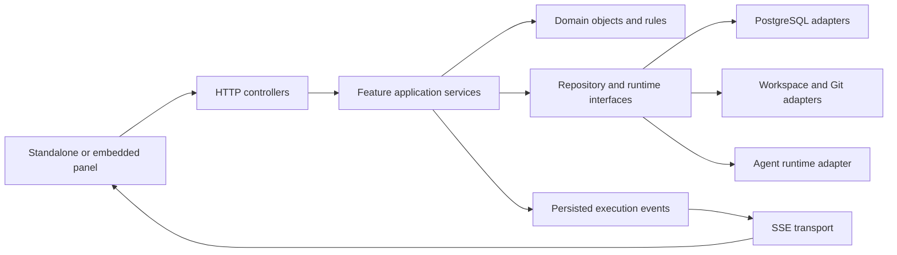

# 01 — Backend overview

Status: **proposal**, based on the current frontend source in `packages/ui/src`.
Kushex is a coding workbench: choose a project, discuss work with an agent,
organize tasks, inspect files and proposed changes, and keep project notes.

## What exists today

| Frontend source | Current behavior | Backend capability needed |
| --- | --- | --- |
| `features/projects/ProjectsScreen.tsx` | Three hardcoded project cards; opening stores the name | Persistent projects with stable IDs and workspace references |
| `features/chat/ChatPanel.tsx` | Placeholder thread selector, messages, steps, context chips, attachment buttons, and changes card | Threads, messages, resolved context, execution events, and change proposals |
| `features/tasks/TasksScreen.tsx` | Local board/list and task tabs; placeholder status, assignee, links, activity, and “Start with agent” | Project tasks, status transitions, relationships, activity history, and execution commands |
| `features/files/FilesSide.tsx` and `FilesMain.tsx` | Static file tree and placeholder editor | Workspace tree and file reads; later versioned writes |
| `features/files/DiffView.tsx` | Hardcoded before/after with Accept and Reject buttons | Reviewable proposals with base revisions and recorded decisions |
| `features/files/BottomPanel.tsx` | Static Problems and Output tabs | Execution diagnostics and output |
| `features/notes/NotesSide.tsx` and `NotesMain.tsx` | Hardcoded notes, local search and draft text | Persistent Markdown notes, pinning, search, and versioned saves |
| `features/settings/SettingsScreen.tsx` | Working appearance controls; placeholder General, Project, Agent fields | Project and agent configuration; browser preferences stay local initially |
| `features/workbench/workbenchSlice.ts` | Activity, project name, file/diff tabs, and mobile region | Replace project name as identity with a project ID; layout state remains in the browser |
| `features/workbench/StatusBar.tsx` | Hardcoded connection, branch, agent, and cursor text | Real connection/workspace/execution state; cursor position stays local |

`app/store.ts` currently registers settings and workbench slices. There is no
implemented RTK Query API, chat transport, or server-backed feature data.
`packages/server/src/index.ts` exposes `/health` and JSON errors only. Compose
provides PostgreSQL and `DATABASE_URL`, but the server has no database client yet.

The [harness wireframe](../harness-plan.md) reflects the current screen direction.
Older [frontend API documentation](../frontend/08-api-contract.md) and parts of the
state/screen documents describe runs, sessions, artifacts, and approvals that are
not implemented in the current UI. Treat those as historical proposals. Retain
useful ideas such as idempotency and stream replay, but define a new workbench API
before connecting these screens. Do not copy their “as implemented” claims.

## Architecture

Start with a **modular monolith**: one Node.js/TypeScript backend, one PostgreSQL
database, and feature modules with explicit contracts. This gives related writes
one transaction boundary without adding service-to-service networking.

In Docker, the browser calls `/api/...` on port `3050`. Nginx or Vite strips
`/api` before forwarding to the backend. Backend routes therefore start at
`/projects`, `/threads`, etc. `/api/health` already reaches `/health` this way.
The embedding API will need configurable API URL and authentication support;
current public panel options do not expose these yet.

## Feature boundaries

| Module | Owns | Collaborates with |
| --- | --- | --- |
| `projects` | Project ID, name, description, project lifecycle | Workspaces, settings |
| `workspaces` | A project's checkout identity, allowed root, branch/revision information | Workspace/Git adapters |
| `chat` | Threads, messages, context references, conversation history | Executions, projects, notes, files |
| `executions` | Coding run lifecycle, runtime handle, cancellation, steps, output, event sequence | Agent runtime, chat, tasks, changes |
| `tasks` | Title, description, board status, assignee reference, links, activity | Projects, chat, executions |
| `files` | Authorized workspace tree, content reads, later versioned writes | Workspaces and workspace filesystem adapter |
| `changes` | Proposed file patches, base revision, review decisions, application state | Executions, workspaces, files |
| `notes` | Project notes, Markdown content, pinning, search, revision | Projects; context reads from chat |
| `settings` | Non-secret project and agent configuration, selected runtime/provider | Projects, executions; secret references from infrastructure |

A **thread** is a durable conversation. A **task** is a project work item. An
**execution** is one agent attempt initiated from a message or task; a task/thread
can have several attempts. Board status (`backlog`, `in-progress`, `in-review`,
`done`) is separate from execution status. Completing an execution does not
silently mark a task done or accept its changes.

Model relationships with stable IDs, project ownership, and explicit references.
Store projects, workspaces, threads, messages, executions, events, tasks, task
activity/links, notes, proposals, and decisions in PostgreSQL. Keep checkout files
in the workspace filesystem; store proposal metadata and the content needed to
review a proposal durably. Final schemas and retention policies are follow-up work.

## Coding chat flow

1. The user selects a project and workspace, opens a thread, and sends a message
   with optional task, note, or file references.
2. `ChatController` validates input; `ChatService` checks project ownership and
   resolves context through explicit collaborators. Save the message and an
   execution request with an idempotency receipt in one transaction.
3. `ExecutionService` claims the queued execution and invokes the injected
   `AgentRuntime`. Initially this can run in the backend process; keep the HTTP
   command short and return IDs rather than holding a request until coding finishes.
4. Normalize runtime callbacks into persisted execution events. SSE streams these
   to the panel for message output, steps, diagnostics, status, and proposal cards.
5. Agent file edits happen in an isolated execution workspace. `ChangeService`
   records proposals against a known base; the reviewed workspace is not changed
   merely because the agent generated a patch.
6. Accepting a proposal checks the current base revision and records/applies the
   decision through `ChangeService`; conflicting files return a conflict for review.
   Rejecting records the decision without applying the proposal.

“Start with agent” uses a task application service to create or reuse an associated
thread and request an execution. It must not duplicate the agent integration in
the tasks controller. A browser disconnect does not cancel an execution.

## Persistence and live updates

- Persist execution identity and status before starting external work. Use explicit
  transitions and an execution claim so retries cannot start the same run twice.
- Persist normalized events before exposing them. Stream with sequence/event IDs,
  replay after reconnect, and bound in-memory buffers. A stale replay cursor must
  trigger a snapshot reload rather than silently losing history.
- Use command IDs and payload identity for message submission, starting an agent,
  cancellation, and proposal decisions. Identical retries return the original
  receipt; a reused ID with different content returns `409`.
- Keep database transactions short; never keep one open while waiting for the
  agent. Record external-effect intent and reconcile failures across database,
  filesystem, and runtime boundaries.
- On backend restart, reconcile queued/running executions. The first implementation
  must mark unrecoverable attempts interrupted; do not promise seamless resume
  without runtime support. A separate worker can be introduced later if needed.
- SSE requires matching proxy configuration: disable Nginx buffering for stream
  routes and configure suitable timeouts/heartbeats when streaming is implemented.

## Boundaries to settle before implementation

The current code does not decide these details. The folder plan preserves seams
for them rather than claiming they already exist:

- Confirm the coding runtime and its actual API. A `KushibotAgentRuntime` is a
  candidate adapter; verify kushibot capabilities before committing to it.
- Define how project repositories reach Docker. The current Compose source mounts
  are for developing Kushex, not for mounting user coding projects. Specify managed
  checkouts or explicit project mounts and an allowed workspace root.
- Choose authentication and single-user versus shared deployment before exposing
  coding actions. Resolve actor/project access server-side, including on SSE;
  a selected project ID is never authorization.
- Choose HTTP routing/validation and PostgreSQL access/migration tools during the
  foundation phase. Native HTTP is the current starting point, not a final
  framework decision. Controllers and repositories isolate these choices.

Normalize and constrain file paths to the authorized workspace, including symlink
resolution. Keep provider credentials on the server, outside settings responses.
These boundaries are required for a backend that reads files and executes coding
work, not separate frontend responsibilities.
