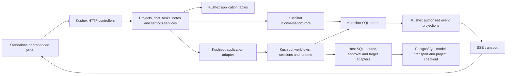

# 01 — Backend overview

Status: **proposal**, based on the current Kushex frontend and the sibling
[kushibot implementation](../../../kushibot/README.md). Kushex is a coding
workbench: choose a project, discuss work with an agent, organize tasks, inspect
files and proposed changes, and keep project notes.

**Kushex is the application and host for Kushibot.** Reuse Kushibot's conversation,
execution, workspace-editing, persistence, and publication capabilities through adapters.
Backend modules expose application use cases and UI projections; they must not
reimplement framework state machines or create competing execution stores.

This overview refines the ownership assumptions in the initial
[folder structure](02-project-structure.md) and [implementation plan](03-implementation-plan.md).
Read their proposed execution/change classes as thin integration facades where
Kushibot already owns the behavior. Proposed `ThreadRepository`, `MessageRepository`,
and PostgreSQL conversation repositories are superseded by Kushibot
`IConversationStore`; do not implement parallel stores in Kushex. The concrete
application integration is still to be built.

## What exists today

| Frontend source | Current behavior | Backend capability needed |
| --- | --- | --- |
| `features/projects/ProjectsScreen.tsx` | Three hardcoded project cards; opening stores the name | Persistent projects with stable IDs and workspace references |
| `features/chat/ChatPanel.tsx` | Placeholder thread selector, messages, steps, context chips, attachment buttons, and changes card | Wire Kushibot conversation storage and map context to sessions, events, and proposals |
| `features/tasks/TasksScreen.tsx` | Local board/list and task tabs; placeholder status, assignee, links, activity, and “Start with agent” | Project task board, relationships, activity, and commands that launch Kushibot work |
| `features/files/FilesSide.tsx` and `FilesMain.tsx` | Static file tree and placeholder editor | Authorized project tree and file reads; mapping to isolated editing workspaces |
| `features/files/DiffView.tsx` | Hardcoded before/after with Accept and Reject buttons | Kushibot proposal projections and trusted review/publication integration |
| `features/files/BottomPanel.tsx` | Static Problems and Output tabs | Views of runtime output, diagnostics, and verification evidence |
| `features/notes/NotesSide.tsx` and `NotesMain.tsx` | Persistent per-actor Markdown notes with autosave, pinning, and search through `/notes` | Use note IDs as chat context |
| `features/settings/SettingsScreen.tsx` | Working appearance controls; placeholder General, Project, Agent fields | Appearance preferences persist per actor through `GET/PATCH /settings`; host and framework configuration remain separate |
| `features/workbench/workbenchSlice.ts` | Activity, project name, file/diff tabs, and mobile region | Stable project/workspace IDs; layout state remains in the browser |
| `features/workbench/StatusBar.tsx` | Hardcoded connection, branch, agent, and cursor text | Actual connection, workspace, and runtime state; cursor position stays local |

`app/store.ts` currently registers settings and workbench slices. There is no
implemented RTK Query API, chat transport, or server-backed feature data.
`packages/server` has the [application foundation](04-foundation.md): lifecycle,
configuration, Prisma Client over PostgreSQL (schema `kushex`), Prisma Migrate as an
explicit migration step, liveness/readiness endpoints and `{ code, message }` errors. It has
no feature routes, application tables, or Kushibot dependency yet.

The [harness wireframe](../harness-plan.md) reflects the current screen direction.
Older [frontend API documentation](../frontend/08-api-contract.md) describes
runs, sessions, artifacts, and approvals that have real counterparts in Kushibot,
but its claims about existing UI queries/types do not match the current frontend.
Reuse the applicable framework contracts when defining the workbench API; do not
assume those HTTP routes or frontend integrations already exist.

## Verified Kushibot capabilities

The following capabilities are present in source and exported by
[`src/index.ts`](../../../kushibot/src/index.ts), not just described in plans.
Public consumers should import from the package root; these source links are
for architectural evidence.

| Concern | Existing implementation | Kushex integration still required |
| --- | --- | --- |
| Execution identity and lifecycle | `ExecutionLifecycle`, workflow/step/session lifecycle definitions, [`WorkflowEngine`](../../../kushibot/src/workflows/WorkflowEngine.ts), `WorkflowRun`, `StepRunner` | Map app requests to registered workflows/executors and expose authoritative status |
| Execution persistence and command identity | [`PostgresqlPersistenceFactory`](../../../kushibot/src/persistence/postgresql/PostgresqlPersistenceFactory.ts), `SqlExecutionRecordRepository`, `SqlWorkflowRunStore`; version checks and save-command receipts | Supply SQL driver binding, scope instances, initialization, app request receipts, and ID mappings |
| Conversations | [`SqlConversationStore`](../../../kushibot/src/persistence/conversations/SqlConversationStore.ts), PostgreSQL/SQLite statement sets, `IConversationStore` | Supply SQL binding and scope, authorize access, map HTTP requests, and explicitly append user/assistant messages |
| Agent sessions and tools | [`AgenticMindUnit`](../../../kushibot/src/agentic/sessions/AgenticMindUnit.ts), `AgenticSession`, `ToolDispatcher`, typed executor registrations, sub-agent coordination | Compose session factories, registered tools/executors, context/journal/acceptance adapters, and thread associations |
| Model calls and routing | `OpenAiTextGateway`, `OpenAiHttpTransport`, gateway registry, budgeted calls and routing policies | Configure transport/credentials, profiles, policies, and permitted capabilities |
| Context and memory | [`AgentContextComposer`](../../../kushibot/src/agentic/context/AgentContextComposer.ts), compression, source-validated memory services | Resolve authorized app notes/files/tasks as context and implement required source/acceptance adapters |
| Isolated text editing | [`SqlTextWorkspaceProvider`](../../../kushibot/src/workspaces/SqlTextWorkspaceProvider.ts), `SqlWorkspaceFiles`, `SqlWorkspaceEditGate`, `SequentialWorkspaceEditor` | Seed selected source files, map app checkout identity, and implement real filesystem/Git access |
| Review and publication | [`ChangeProposalService`](../../../kushibot/src/publication/ChangeProposalService.ts), [`PublicationCoordinator`](../../../kushibot/src/publication/PublicationCoordinator.ts), `SqlPublicationStore` | Supply review/check evidence, trusted human approval reader, actual target apply/reconcile adapter, and UI decision handling |
| Artifacts, diagnostics, and budgets | PostgreSQL artifact factory, [`SqlDebugEventStore`](../../../kushibot/src/events/debug/SqlDebugEventStore.ts), `BoundedDebugPublisher`, `SqlUsageLedgerStore` | Initialize/configure stores, authorize reads, and project evidence into panel views and SSE |
| Startup, shutdown, and recovery | [`FrameworkRuntime`](../../../kushibot/src/runtime/FrameworkRuntime.ts), startup/shutdown coordinators, workflow cancellation/checkpoint/recovery coordinators | Register owned/borrowed resources and supply real fencing, checkpoint, quiescence, and recovery evidence adapters |

Important limits of the current implementation:

- **SQL support is not a bundled driver.** Kushex must implement
  [`ISqlDatabase`](../../../kushibot/src/persistence/sql/ISqlDatabase.ts), including
  single-connection transactions, rollback, safe result conversion, and serialized
  migrations. Framework stores supply their schema/SQL behavior; the host wires
  their initialization. Do not rewrite those stores as app repositories.
- **A session is not an app conversation.** `ISessionJournal` is a host contract;
  the agent session loop does not supply a ready-made durable chat-thread API.
  Conversation storage is now a separate Kushibot capability: `IConversationStore`
  persists threads and ordered user/assistant messages, with pagination, optional
  run/session links, and idempotent creation. Kushex owns the conversation UX, access
  checks, selected context, and mapping to runs; it calls this store rather than
  creating duplicate thread/message repositories. Hosts still supply session journal
  persistence where needed; conversations are not captured automatically.
- **The model gateway is non-streaming text today.** SSE can deliver completed
  messages, lifecycle events, steps, and diagnostics. Token-by-token model output
  needs an explicit framework/transport extension; it is not supplied by wrapping
  the current `generate()` call in SSE.
- **SQL text isolation is not a Git checkout or process sandbox.** The current
  workspace provider bounds seeds to 256 files, 64 KiB per file, and 1 MiB total,
  with restricted paths/text. Plan selected-file editing or a deliberate provider
  extension; do not promise arbitrary repository/binary/shell support.
- **Publication is host-backed.** An Accept button alone is not verified human
  approval or an applied filesystem change. The host must authenticate the actor,
  bind approval to the proposal digest, provide evidence, and implement a target
  whose actual effect can be reconciled.
- **Recovery is conditional on adapters.** Coordinators exist, but production
  fencing/quiescence and real-driver behavior still need integration validation.
  The sibling README explicitly distinguishes offline fixtures from host-backed
  SQL, publication, and process acceptance checks.

## Architecture

Start with a **modular monolith**: one Kushex Node.js/TypeScript backend hosting
Kushibot, backed by PostgreSQL. App and framework storage may share a physical
database, with distinct schema/table ownership and explicit transaction boundaries.

`KushibotAgentRuntime` is the intended application adapter, subject to defining its
contract against the verified public API. It composes existing framework objects
and hides integration details from controllers; it is not a second agent engine.
Use constructor-injected interfaces and polymorphism for real runtime/host variants
and test doubles. Reuse Kushibot contracts directly where they already fit.

In Docker, the browser calls `/api/...` on port `3050`. Nginx or Vite strips
`/api` before forwarding to the backend. Backend routes therefore start at
`/projects`, `/threads`, etc. The embedding API will need configurable API URL
and authentication support; current public panel options do not expose these yet.

## Feature ownership

| Module | Kushex owns | Delegates to Kushibot |
| --- | --- | --- |
| `projects` | Project catalog, name, description, access, stable identity | Map IDs to framework execution scope |
| `workspaces` | Checkout registration, allowed root, branch/revision metadata, host Git/filesystem adapters | Isolated text workspaces and revision-checked editing |
| `chat` | Conversation use cases, access checks, selected context and thread/run mapping | Durable threads/messages through `IConversationStore`, agent sessions, context, tools and model execution |
| `executions` | Submit/cancel endpoints, app-command receipts, app-to-run associations and read projections | Lifecycle, attempts, run persistence, budgets, cancellation and recovery machinery |
| `tasks` | Board states, descriptions, assignee references, links and task activity | Execute task work through registered workflows/executors |
| `files` | Authorized project tree/content API and checkout source resolution | Reads/edits within supported isolated framework workspaces |
| `changes` | Diff presentation, authenticated decisions and target integration | Proposal digest, evidence/approval checks, publication claim and reconciliation |
| `notes` | Project Markdown documents, pinning, search, versions | Consume notes as verified context; agent memory remains separate |
| `settings` | Persist non-secret app/project settings and secret references | Validated framework configuration, model profiles and policies |

A **thread** is a durable app conversation. A **board task** is a project work
item, distinct from a framework execution input. An **execution** refers to
Kushibot run/session identities; a task/thread can link to multiple attempts.
Task status (`backlog`, `in-progress`, `in-review`, `done`) is independent of
framework lifecycle. Finishing an agent execution does not approve its changes
or automatically finish the task.

Kushex tables hold app entities, launch-command receipts, ID associations, and
any rebuildable UI projections. Kushibot stores remain authoritative for durable
conversation threads/messages as well as execution records, debug events, artifacts,
usage, isolated editing state, and publication records. Do not create parallel
authoritative copies. Use real project files as source input and publish approved
changes through a host target adapter.

## Conversation storage integration

Conversation persistence is implemented in the sibling Kushibot source; the Kushex
backend and UI are not connected to it yet. See the
[conversation storage guide](../../../kushibot/docs/conversations/README.md) for
its supported contracts and real-driver acceptance commands.

- Construct a `SqlConversationStore` with the host `ISqlDatabase`,
  `postgresqlConversationStatements`, and the actor-authorized effective scope.
  Initialize its tables during controlled startup. Inject `IConversationStore`
  into `ChatService`; controllers must not depend on SQL statements or a concrete
  database implementation.
- Use `createThread`, `getThread`, and `listThreads` for the thread selector and
  new-thread action. Use `appendMessage`, `getMessage`, and `listMessages` for
  conversation history. IDs must be stable; display names are not identities.
- History is ordered by a store-assigned sequence within each thread, with
  `afterSequence` pagination. Thread lists use `afterThreadId`; both support limits
  from 1 to 100. Keep the last observed sequence when polling an existing thread.
- Reuse message/command IDs, exact content, creation timestamp, and optional
  run/session IDs on retries. Identical appends return the stored message;
  conflicting reuse returns `IDENTITY_CONFLICT`, which Kushex should map to HTTP
  `409`. Appends are immutable; links supplied later require a separate app
  association rather than rewriting an existing message.
- Explicitly persist user messages and completed assistant responses. Kushibot
  does not automatically copy session journals, tool observations, or model replies
  into conversation history. Verify run/session ownership before linking them.
  A conversation history read remains independent of execution diagnostics/SSE.
- The current store supports user/assistant text and optional run/session IDs.
  Selected context chips, attachments, launch intents, and task associations need
  explicit app contracts; do not assume the store already persists those fields.

Conversation persistence has passed the new SQLite and PostgreSQL acceptance
suites, including ordering, paging, scope isolation, concurrent writes, rollback,
and retry after a lost commit acknowledgement. This verifies the library store;
Kushex still needs its own database binding, authenticated HTTP integration,
message-to-execution reconciliation, and frontend integration checks.

## Coding chat flow

1. The user selects a project/workspace and sends a message with optional context
   references. Kushex validates actor access and saves the message through
   `IConversationStore.appendMessage()` with stable message/command IDs. Record a
   durable app launch intent linked to that message. The conversation store owns its
   transaction, so reconcile the two writes; do not claim a single atomic operation
   unless transaction participation is explicitly added.
2. A Kushex dispatcher resolves that intent to stable Kushibot scope, run/session,
   and operation IDs. `KushibotAgentRuntime` starts registered work through the
   composed framework runtime and workflow/session facilities. Reconcile retries
   against those identities rather than starting another engine attempt blindly.
3. Host context adapters resolve permitted files, notes, and tasks; Kushibot composes
   context and runs its session/tool/model logic. Keep the HTTP submission short.
4. Kushex explicitly appends completed assistant responses to `IConversationStore`
   with stable IDs and any known run/session links. Project framework diagnostics
   and lifecycle separately into SSE. Reconcile failed response persistence rather
   than assuming the session journal has saved a chat message. Do not claim token
   deltas from the non-streaming gateway.
5. Edits use a supported isolated workspace. Create a framework proposal tied to
   its baseline/digest and display it in the chat changes card and diff view.
6. Kushex records the authenticated user's decision. Accepted publication goes
   through Kushibot's coordinator with verified review/check evidence, trusted
   approval, and a real target adapter. The target enforces checkout/base revision
   checks and reports/reconciles actual effects. Record rejection without applying.

“Start with agent” creates/links an app conversation and delegates the launch
through the same integration. Browser disconnects do not cancel agent work.

## Persistence, events, and lifecycle

- Reuse framework record versions, workflow claims, and command receipts for the
  operations they cover. Add app-level idempotency for chat/task HTTP commands;
  `IConversationStore` deduplicates message appends within a thread, but that alone
  does not deduplicate or atomically commit the associated workflow launch.
- Sharing PostgreSQL does not make app writes and all framework effects one atomic
  operation. Use durable launch intent plus reconciliation; inspect transaction
  participation before promising atomic cross-store updates. Never hold a database
  transaction open across an agent call or filesystem/publication effect.
- Serve scoped, paged framework debug events through an app-owned SSE transport,
  with stable event/sequence cursors and bounded buffers. `BoundedDebugPublisher`
  is a diagnostic publisher, not a durable chat broker; define which stored events
  are required for UI replay and how missing history triggers snapshot reload.
- Keep app-specific conversation events distinct from framework diagnostics if
  needed. Persist the former only when they carry app information unavailable in
  the framework, and link them by run/session/operation identity.
- Let `Application` own HTTP and host resources, composing `FrameworkRuntime` for
  framework startup/admission/draining. Assign each pool/client one owner and use
  borrowed resources where appropriate to avoid double closing.
- Reuse cancellation/recovery coordinators when their required host adapters are
  implemented. Otherwise expose unresolved/interrupted state honestly; do not
  synthesize successful completion or assume unknown external effects did not occur.
- Configure Nginx buffering, heartbeat and timeout behavior when adding SSE.

## Integration decisions before implementation

- **Dependency and version:** the inspected sibling declares package name
  `kushibot`, version `0.0.0`. Older Kushex references to `@kushibot/core` are not
  proof of the current package identity. Choose a reproducible local/package build
  dependency and Docker build context; the current context excludes the sibling.
- **Framework composition:** register the actual coding workflow, executors,
  policies, tools, model transport, context sources, session journal, acceptance
  checks, trusted approval source, and publication target. These are required
  integrations, not a reason to rebuild their framework counterparts.
- **Database binding:** choose a PostgreSQL driver and implement/test `ISqlDatabase`
  transaction and migration-lock semantics. Initialize the selected framework
  stores as well as app migrations with explicit ownership/order.
- **Workspace scope:** decide selected-file SQL workspaces versus an additional
  provider for larger/other workloads. Define source checkout mounts, realpath and
  symlink boundaries, revision checks, and host publication/reconciliation behavior.
  Existing Compose source mounts are for developing Kushex, not user repositories.
- **Identity and transport:** define actor/project authorization for HTTP, SSE,
  file sources and approvals. Framework scope isolation complements host access
  checks; the project picker is not authorization. Keep credentials server-side.
- **Acceptance:** verify real PostgreSQL rollback/concurrency, duplicate launches,
  event replay, publication conflict/reconciliation, and shutdown/recovery with
  actual host adapters. Source inspection confirms implementation, not deployed
  readiness or passing host-backed acceptance tests.
