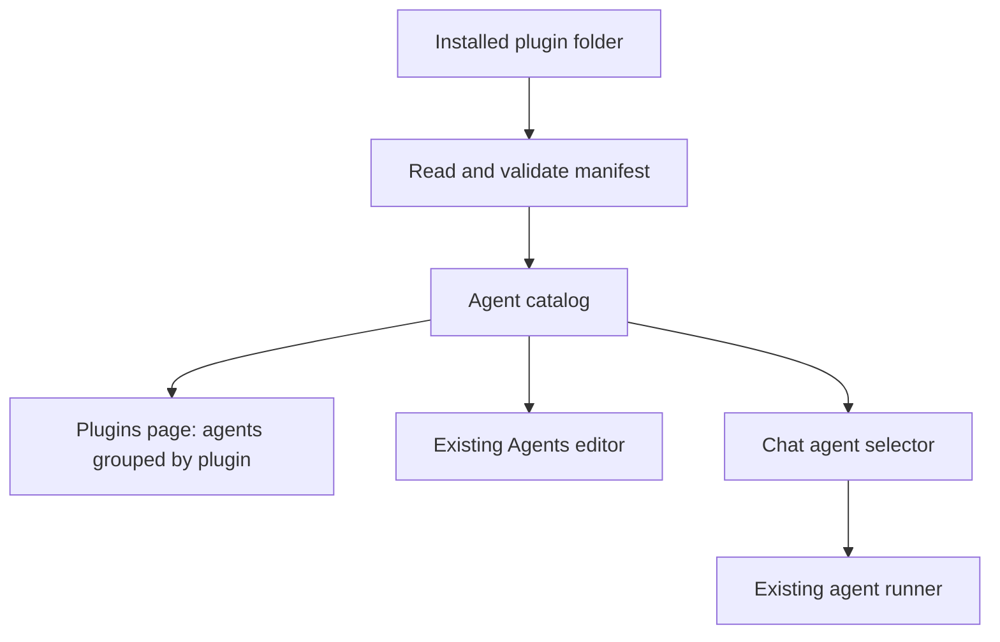

# Idea: install agents through plugins

**Status:** implemented. The first version discovers local agent plugins at startup.
See [the agent guide](../../plugins/README.md#local-plugins) for installation and runtime details.

## 1. What the first version does

A plugin is a folder containing a manifest and one or more agents. Installing the
plugin makes its agents available in Kushex.

For example, a **Development Agents** plugin could provide a coding agent and a
review agent. After installation, the user can:

1. Open **Plugins** and select **Development Agents** to see its agents.
2. Open one of those agents in the existing Agents editor.
3. Select that agent in the project chat and send a message.
4. Edit its files and debug it using the existing agent workflow.

**The first version contributes agents only.** It does not add plugin-defined
pages, tools, capabilities, event handlers, or background services. The Plugins
page is part of Kushex itself and displays plugin metadata and agents.

## 2. How it works

The system needs three parts:

| Part | Responsibility |
| --- | --- |
| Plugin manifest | Describes the plugin and lists its agents |
| Agent catalog | Connects each agent ID to its plugin and source folder |
| Existing agent features | Use the catalog to browse, edit, select, run, and debug agents |



Registering an agent means adding its metadata and source location to the catalog.
It does not execute the agent. The existing runner loads its entry file when the
user sends a chat message.

## 3. Plugin format

Use a local folder format for the first version:

```text
plugins/
  development-agents/
    kushex-plugin.json
    agents/
      coding/
        agent.ts
        prompts/instructions.ts
      reviewer/
        agent.ts
```

Example manifest:

```json
{
  "id": "development-agents",
  "name": "Development Agents",
  "version": "1.0.0",
  "apiVersion": 1,
  "agents": [
    {
      "id": "coding",
      "name": "Coding",
      "description": "Implement and debug code changes.",
      "directory": "agents/coding",
      "entry": "agent.ts"
    },
    {
      "id": "reviewer",
      "name": "Reviewer",
      "description": "Review code changes.",
      "directory": "agents/reviewer",
      "entry": "agent.ts"
    }
  ]
}
```

`directory` is relative to the plugin folder. `entry` is relative to the agent
directory. The full agent directory, including prompts and other imported files,
is available in the existing editor.

Agent IDs are globally unique and follow the existing agent-name format. Keep
`coding` as the coding agent's ID so `/agents/coding`, chat selections, notes,
and breakpoints continue to resolve. Display names can change without changing IDs.

## 4. Step-by-step implementation

### Step 1 — Define the manifest and catalog records

Add shared contracts for plugin metadata and agent contributions. Internally,
each catalog entry records the agent ID, display name, description, owning plugin,
resolved source directory, and entry file. Absolute server paths stay internal;
the UI receives metadata and uses existing file APIs.

Validate manifests before registering agents. Reject unsupported API versions,
duplicate plugin or agent IDs, missing entries, and paths that escape their
plugin or agent directory, including escapes through symlinks. Report errors
against the affected plugin. Never silently choose between duplicate IDs.

**Result:** Kushex has one definition of an installed plugin and its agents.

### Step 2 — Discover locally installed plugins

Read plugin folders from a configured plugins directory when the server starts.
For this version, installation means placing a complete plugin folder there and
restarting Kushex. Removal means removing the folder and restarting. Valid
plugins are available automatically; a marketplace, upload flow, enable/disable
controls, and automatic reload are outside this version.

A malformed plugin should appear with an error in the Plugins page, while valid
plugins remain available. Register each plugin atomically: if any of its agent
contributions is invalid, register none of that plugin's agents. If IDs conflict,
mark the conflicting plugins unavailable rather than making discovery order decide.

**Result:** adding a local package makes its agents discoverable without editing
Kushex application code.

### Step 3 — Package the coding agent as an independent plugin

The coding plugin lives in `plugins/coding/`, with its own `package.json` and
`kushex-plugin.json`. Its contribution uses `directory: "."`, `entry: "agent.ts"`,
and the unchanged agent ID `coding`. The default plugins directory is `plugins/`;
all packages there use the same discovery and validation rules.

There is no special Local Agents plugin, implicit migration of agent folders, or
panel agent creation. Add agents by explicitly editing package manifests and
restarting the server. Editing files within an installed agent remains supported.

**Result:** the coding agent is a normal plugin package with stable source paths
and saved references.

### Step 4 — Make the editor and runner resolve agents through the catalog

Replace assumptions that every agent lives at `agents/<name>` with catalog
lookups. File operations resolve paths within the selected agent's source folder.
Runs resolve the entry file from the same catalog record and use the existing
`chat` contract, Node process, project working directory, and cancellation flow.

Keep `/agents/:agentId`, including `/agents/coding`. Preserve the file tree,
revision-checked saves, imports, notes, breakpoints, and debugger. Update source
path mapping and type resolution where they assume the old directory layout.

For the first version, installed plugins are local source packages. The editor
writes directly to their agent files, and new runs use those saved files. A
non-writable source remains viewable and produces a clear error on save. Package
dependency installation is manual; document the supported agent dependencies and
keep existing kushibot resolution working for external plugin locations.

**Result:** an agent from another plugin opens and runs through the existing
agent workflow.

### Step 5 — Add the Plugins page

Add host-owned routes such as `/plugins` and `/plugins/:pluginId`.

The first page lists discovered plugins with their names, versions, agent counts,
and errors. Selecting a plugin shows every agent it contributes, with its name,
description, and an **Open agent** link to `/agents/:agentId`. Show the plugin
name in the agent editor so the user knows which package they are editing.

**Result:** the user can select a plugin and browse all of its agents.

### Step 6 — Populate the chat selector from the same catalog

Return registered agents through the existing agent-list API, including their
plugin metadata. Use that list in both the Agents activity and chat selector.
Group or label chat choices by plugin, while keeping the selected value as the
stable agent ID.

When a plugin is removed, preserve chat history, notes, breakpoints, and saved
agent selections. Show a missing selected agent as unavailable and reject new
runs for it. Installing it again with the same IDs restores resolution.

**Result:** selecting an installed plugin's agent in chat launches that agent.

### Step 7 — Verify the complete workflow

Use the built-in coding agent and a second local plugin containing two simple
agents. Check that:

- The Plugins page lists both plugins and their agents.
- All registered agents appear in the chat selector and Agents activity.
- `/agents/coding` and existing saved references continue to work.
- An external agent's files can be opened, edited, saved, run, and debugged.
- Bare agent folders are not registered or migrated; manifests are never rewritten.
- The panel and API do not offer agent creation.
- Invalid manifests, duplicate IDs, and escaping paths produce clear errors.
- Removing a plugin makes its agents unavailable without deleting chat history.
- The navigation and agent workflow work in standalone and embedded panels.

**Done means:** a local plugin can contribute multiple agents, and the user can
find them by plugin, edit them, select them in chat, and run or debug them through
Kushex's existing agent features.

## 5. First-version boundary

This version loads local agent code with the existing runner's access and trust
model. Installing a plugin therefore means trusting its agent code. It does not
introduce a new sandbox or permission system.

Plugin-defined UI, shared tools, secret storage, remote installation, updates,
and richer extension APIs can be designed separately after this agent-only flow
works.
